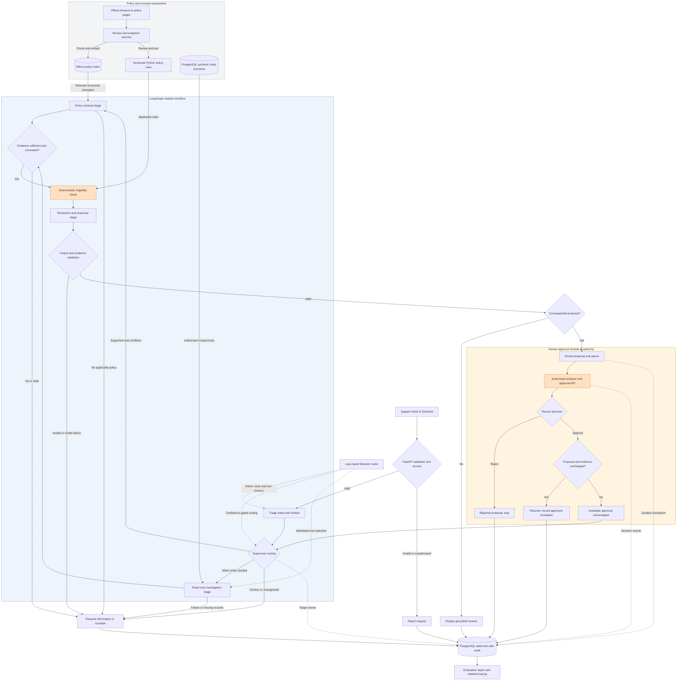

# Proposed agentic flow for Amazon India support

Status: design proposal, not implemented.
Marketplace: Amazon.in only.
Date: 2026-10-29.

## Data choice

Use explicitly synthetic India order scenarios, customers, tickets, delivery events, return records and refund records. These represent a fictional demonstration environment, not actual Amazon accounts or orders. Use selected official Amazon.in policy snapshots as reference evidence. Olist remains an optional, separate historical investigation dataset; Amazon policies do not govern original Olist orders.

No category-specific eligibility thresholds have been verified or encoded at this design stage. Before implementation, review the selected official pages and record source URL, marketplace, retrieval timestamp, local snapshot ID, content hash, category and scope. Record an effective date only when the source provides one; retrieval time does not establish historical applicability.

## Pattern choices

The requested pattern catalog presents foundational techniques including ReAct, function calling, RAG, supervisor-worker, and reflection, alongside routing, parallelization, workflow orchestration, human interaction, evaluation, security, and fault tolerance. This design applies only patterns that fit the seven-day MVP:

- **Supervisor-worker with typed routing:** Laya makes bounded choices for intent, specialist route, and tool selection. It does not own workflow state or perform actions.
- **Prompt chaining and parallelization:** validate, triage, gather policy and operational evidence in parallel when both are needed, consolidate, apply rules, then draft and validate.
- **RAG with source provenance:** retrieve versioned Amazon.in passages; insufficient or conflicting evidence causes clarification or escalation.
- **Function calling with least privilege:** typed allowlisted read-only investigation tools; approval remains an authenticated application operation.
- **Human-in-the-loop with durable state:** pause consequential proposals for review and resume from a persisted checkpoint.
- **Guardrails, fault handling and evaluation:** deterministic access and policy checks, bounded retries, safe fallbacks, red-team cases, and labelled metrics.

Pattern source: [Agentic Design Patterns](https://agentic-design.ai/patterns). The catalog describes pattern families; the mapping above is this project's design choice.

## Orchestration boundary

Laya is used as a **decision and routing component**: its documented typed `choice`, `score`, and yes/no decisions can classify intent, estimate route confidence, and select among a fixed list of specialist stages or tools. Keep a confidence gate and deterministic allowlist around its outputs. Laya does not generate customer prose, retrieve evidence, enforce business policy, authorise approval, or manage durable workflow state.

LangGraph remains the **workflow orchestrator** from the supplied technology stack. It owns graph transitions, shared state, parallel branches, conditional paths, retries, and persisted interrupts/resumption. This division is necessary because Laya documents itself as a typed decision engine and documents integration with LangGraph, rather than as a durable stateful workflow engine. FastAPI remains the authenticated service boundary; PostgreSQL persists workflow state and audit; Milvus serves policy retrieval.

Laya sources: [Laya overview](https://nandhakishorm.github.io/laya/), [typed decisions](https://nandhakishorm.github.io/laya/structured/), [LangChain and LangGraph integration](https://nandhakishorm.github.io/laya/).

## Complete flow

## What each stage does

1. Policy preparation is an offline, reviewed process. Approved policy passages are chunked and embedded with metadata using LangChain integrations and Sentence Transformers, then indexed in Milvus. A keyword baseline uses PostgreSQL full-text search or BM25. Humans translate supported conditions into versioned, tested Python rules; an LLM does not authorise policy changes.
2. A support agent submits a synthetic customer ticket through Streamlit. FastAPI authenticates the caller, validates the request and establishes authorised customer/order scope before graph execution. Individual tools enforce record-level access again.
3. Laya makes a typed, bounded intent decision; the classifier extracts only supported identifiers. Begin with order status, delivery delay/non-delivery, damaged item, incorrect item, return eligibility, refund eligibility/status and general policy questions. Low-confidence and unsupported cases request clarification or escalate.
4. Laya can choose a specialist stage or allowlisted read tool from a fixed schema. LangGraph checks the decision against the workflow state and policy gates, then executes the transition. Policy-only questions do not require an order lookup. When both policy and operational evidence are needed, the two stages can run concurrently; evidence consolidation waits for all required stages.
5. Policy retrieval returns passages, exact source references and snapshot metadata filtered to Amazon.in and the relevant scope. No applicable policy, stale evidence or unresolved conflicts lead to review.
6. Investigation uses allowlisted, typed, read-only tools for order summary, delivery timeline, order items, return state and refund state. Tool failures and unknown records produce explicit outcomes, not invented facts. Synthetic refund records support a status query but do not prove a real refund occurred.
7. Evidence consolidation distinguishes verified scenario records, retrieved policy statements, missing facts, conflicting evidence and unsupported customer assertions.
8. Deterministic rules produce permitted options, ineligibility reasons or escalation. The response stage uses one configured LLM provider to draft only from those options and evidence. Laya is not the prose generator.
9. Output validation checks schema, source support, policy compliance, personal-data exposure and whether approval is required. A failed validation or model call produces a controlled review outcome; any retry must be bounded.
10. Informational answers are displayed in the dashboard. Consequential proposals are persisted and pause for an authorised reviewer. No proposal is treated as already executed.
11. The approval API is separate from agent tools. It verifies reviewer role, current proposal version and evidence snapshot; retries are idempotent. Rejection records a reason and stops the proposal. Approval resumes only the simulated workflow. Changed evidence invalidates the old approval and requires renewed investigation and a new review.
12. Persist checkpoints, proposals, evidence references, decisions and safe audit events in PostgreSQL. All stages record status, request ID, timing and error category; diagram stage-event arrows are representative, not an exhaustive logging map. Langfuse receives masked traces only. Failure of tracing does not authorise an action or invent a result.
13. Held-out labelled cases evaluate classification macro-F1, retrieval Recall@K, claim support, deterministic policy compliance, authorised approvals, prompt injection, cross-customer access, failure handling and latency. Audit records provide operational observations, not ground-truth labels.

## Agent boundaries

The supervisor and specialist stages are nodes in one LangGraph workflow, not separate autonomous services. Laya supplies structured decisions to that workflow; it does not replace the graph. Classification, retrieval, access checks, evidence validation, eligibility and approval should use deterministic code wherever practical. The configured generative LLM interprets language when needed and drafts grounded responses. Human approval is an application requirement for this demonstration, not a claim about Amazon's internal approval process.

## Deliberate scope limits

No real refund, replacement, compensation, return pickup, reward issuance, or loyalty adjustment is executed. No live Amazon account or order-system integration is included. Local loyalty investigation now uses a synthetic, bounded ledger and prior-contact fixture; it does not connect to a real rewards programme or establish eligibility. Amazon Reviews and UCI Online Retail II are not needed for the main demonstration.

## Illustrative ticket path

A damaged-item ticket is classified, the applicable policy snapshot and synthetic order facts are retrieved, and required condition and return-eligibility evidence is checked. If facts are missing, the case asks for information. If a reviewed rule permits a consequential proposal, it enters the approval queue. Approval records an approved simulation; rejection records the reason and stops the proposal. This example assumes no universal return window.

## Technology mapping

- Dashboard: Streamlit.
- API and schemas: FastAPI and Pydantic.
- Workflow: LangGraph with durable checkpoints.
- Typed intent, stage and tool routing: Laya, confidence-gated and constrained to allowlists.
- Classification: Laya typed choices at runtime, with the scikit-learn baseline retained as an explicit review-only fallback.
- Policy ingestion/retrieval: LangChain, Sentence Transformers, Milvus, keyword baseline.
- Operational records, workflow state and audit: PostgreSQL with SQLAlchemy and Alembic.
- Business rules and permission checks: Python.
- Language assistance: one configured LLM provider.
- Observability: structured logging and masked Langfuse traces.
- Verification: pytest, HTTPX and labelled evaluation sets.
- Reproducible local setup: Docker Compose.

