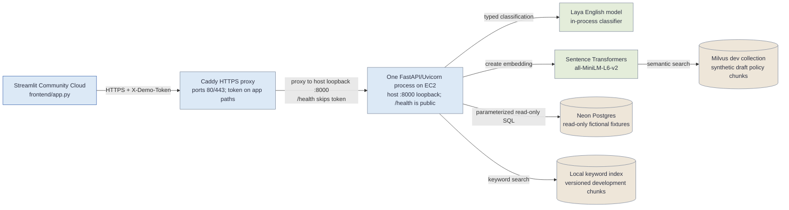
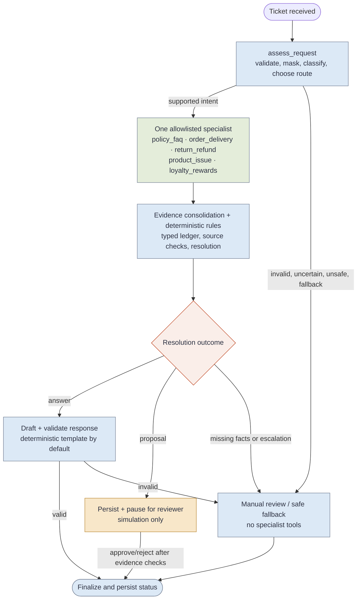

# Project guide: Agentic Customer Experience and Supply Chain Resolution

This guide describes the repository as reviewed on **7 November 2026**. It is written for someone who has not seen the project before: it explains the user interface, the implemented techniques, the agents and MCP tools, the dependencies, the local run path, and the EC2 demo deployment.

## 1. What this project does

This is a controlled customer-support investigation demo. A support user submits a ticket or question. The API checks the input, classifies the request, reads bounded fictional order and customer-context records, retrieves synthetic policy passages, and returns evidence for a human to review. The workflow may produce a grounded answer, ask for more information, escalate the case, or create a **simulation-only** proposal for review.

The assistant does not connect to a live retailer's order system or execute refunds, replacements, compensation, points changes, payments, or customer messages. The records are fictional development fixtures; the policy documents are synthetic drafts. Neither is approved for production decisions.

### Status labels used below

| Label | Meaning |
| --- | --- |
| **Implemented** | The behavior exists in the current source code. |
| **EC2 demo** | Included in the small one-container API deployment documented in this repository. |
| **Full workflow profile** | Requires a configured workflow database and a separate worker; this is not part of the EC2 investigation demo profile. |
| **Design only** | Described in a proposal or target architecture but not the current behavior. |
| **Not production-ready** | Depends on fictional data, draft policies, demo credentials, or missing production controls. |

## 2. User interface tour

The UI is a Streamlit app in [`frontend/app.py`](../frontend/app.py). It sends requests to the FastAPI API. It does not connect directly to Neon, Milvus, or Laya. The sidebar holds the API base URL, health check, and support/reviewer credentials. Credentials entered into token fields are masked and are not written to project files.

### Investigation workbench

The workbench has two engine choices:

- **Investigate Tool** calls the direct fixture investigation endpoint. It is the mode supported by the EC2 demo. It returns review-only classification and read-only evidence without starting a durable background workflow.
- **Workflow** starts a LangGraph run through `POST /workflows`. A worker must be running and `WORKFLOW_DATABASE_URL` must be configured. The EC2 demo profile does not run that worker or its workflow database.

The context controls accept an optional ticket ID, order ID, `top-k` value, and retrieval methods (`semantic` and/or `keyword`). The processing view can show workflow status, current stage, timeline events, classifier provider and confidence, specialist, evidence references, order and customer-context evidence, policy passages, the typed evidence ledger, deterministic rule result, and validated response. The confidence score is a routing signal, not a calibrated probability.

When a proposal is pending, a separate reviewer can approve or reject it. Approval records an approved simulation only. The UI cannot carry out a real commerce action.

### Data explorer

This page provides the local fixture tools in tabs:

- classify a message or investigate a fixture ticket;
- read order, delivery, and return/refund facts;
- optionally inspect synthetic loyalty and prior-contact context;
- combine an order lookup with a policy search; and
- search policy passages with semantic, keyword, or both methods.

These are local-development fixture endpoints. The API's local-development guard rejects them outside `APP_ENV=local`, `dev`, or `development`. They must not be exposed as production APIs.

### RAG evaluation lab

The lab can evaluate one query or the checked-in labeled question set. It compares semantic and keyword retrieval and displays expected-document Hit@1, Hit@k, MRR, scope compliance, citation-metadata completeness, and returned excerpts.

The evaluation feature is implemented, but a labeled-set run can be slow or time out when it performs multiple serial embedding and retrieval calls. The Streamlit batch request has a 90-second client timeout. Treat HTTP 504 as an evaluation/runtime timeout, not as a successful score. Start with one query or one method while diagnosing latency.

### Agents & data flow

This page explains the stages, shows the prepared synthetic-data and baseline metric snapshot when those artifacts are available, warns that the policy corpus is draft-only, and shows an MCP tool list. The server currently registers **nine** MCP tools; the UI's overview list currently displays eight and omits `get_customer_support_context`. The complete server list is in [Section 6](#6-mcp-server-and-tools).

### Screenshot spaces

The repository does not currently contain final product screenshots for this guide. Save screenshots under `docs/screenshots/` using the filenames below, then replace each reserved slot with an image link. Before sharing a capture, hide tokens and account details; use fictional ticket/order IDs.

| Reserved slot | Suggested file | Capture |
| --- | --- | --- |
| **Screenshot 1 — Investigation workbench** | `docs/screenshots/01-investigation-workbench.png` | Workbench with a completed Investigate Tool result, classifier provider, answer, and evidence panel visible. |
| **Screenshot 2 — Workflow timeline** | `docs/screenshots/02-workflow-timeline.png` | Local full-workflow run showing stage events, specialist, evidence references, and final status. |
| **Screenshot 3 — Data explorer** | `docs/screenshots/03-data-explorer.png` | Ticket classification and read-only order or policy evidence; keep the local-fixture notice visible. |
| **Screenshot 4 — RAG evaluation** | `docs/screenshots/04-rag-evaluation.png` | A successful single-query result or labeled-set metrics, with the selected methods visible. |
| **Screenshot 5 — Agents and MCP** | `docs/screenshots/05-agents-and-mcp.png` | Agents & data flow page with the stages, guardrail warning, and MCP tool list. |
| **Screenshot 6 — EC2 deployment** | `docs/screenshots/06-ec2-deployment.png` | Optional AWS console or terminal capture showing instance status/health without credentials or private key material. |

> **Reserved image area:** Screenshot slots are listed above. Replace this note with the screenshots after they have been captured and reviewed.

## 3. Techniques used

| Technique | How this project uses it | Current limit |
| --- | --- | --- |
| Structured intent classification | Laya's in-process `Router` returns an allowlisted typed intent and confidence. It also performs an input-safety choice. See [`backend/app/classification/laya.py`](../backend/app/classification/laya.py). | Model scores are not calibrated. A failed/unsafe/abstaining result must be reviewed. The old HTTP-playground instructions in some Day 4 notes do not match the current in-process adapter. |
| TF-IDF baseline | scikit-learn provides a local fallback classifier. Its result is marked as fallback and cannot authorize automatic routing. | A fallback classification is for human review only. |
| Confidence-gated allowlisted routing | A deterministic supervisor maps recognized intents to one of five specialist stages. Threshold, safety, fallback, and triage flags can send a request to manual review. | Automatic routing is disabled by default in the workflow configuration; the model cannot pick arbitrary tools or graph nodes. |
| Semantic and keyword retrieval | Sentence Transformers `all-MiniLM-L6-v2` embeds text for search in a development Milvus collection. A separate keyword baseline searches the local versioned chunks. | The code runs selected methods serially. The indexed corpus contains synthetic development drafts, not approved policy. |
| Retrieval evaluation | The labeled set reports Hit@1, Hit@k, MRR, scope compliance, and citation metadata completeness. | The set is small and synthetic; it does not estimate production quality. Batch runs may be slow. |
| Bounded read-only data access | Typed Python tools call parameterized SQL for allowlisted order, delivery, return, loyalty, and prior-contact fields. | The data is fictional; the legacy fixture endpoints are local-only and do not provide production identity-to-order authorization. |
| Evidence ledger and citations | Evidence is kept separated by source and summarized into a typed ledger with references, missing facts, and conflicts. | A retrieval match is not proof that a policy applies. Draft policy passages must not decide eligibility. |
| Deterministic rules and safe outcomes | Python rules check evidence and supported conditions before answering, asking a question, escalating, or proposing a simulation. | Business policy and action rules are demo-only; there is no live execution tool. |
| Grounded response and validation | A deterministic answer template is the default. An optional configured Groq/OpenAI-compatible model can draft text, with no tools. Output validation rejects unsupported claims or references. | Optional model output is not an authority for policy or approval. General semantic entailment is not proven. |
| Human-in-the-loop checkpoint | The full LangGraph profile can pause at a proposal, revalidate evidence, and record approve/reject decisions idempotently. | Approval means simulation only. Approval resume is synchronous in the API and has no automatic retry after process failure. |
| Privacy and safe failure | Input masking, scope checks, bounded schemas, request IDs, safe error categories, and review fallbacks protect the demo flow. | These controls do not replace production identity, retention, audit, and operations controls. |

## 4. Architecture diagrams

The fenced Mermaid diagrams below render in Markdown viewers that support Mermaid. Editable source files are [`architecture-current.mmd`](architecture-current.mmd) and [`agentic-flow.mmd`](agentic-flow.mmd). Keep the source files and the copies below in sync when updating the diagrams.

### Current EC2 investigation demo

This is the deployment profile described by [`ec2-demo.md`](ec2-demo.md) and [`ec2-run-and-deploy-guide.md`](ec2-run-and-deploy-guide.md). The values shown for the host were reported in the project deployment session; the exact EC2 instance type was not confirmed.



The EC2 host details recorded in the deployment session were Ubuntu x86_64, 2 vCPU, 3.7 GiB RAM, and a 24 GiB root disk; the EC2 instance type was not confirmed. The API container has a 3 GiB memory cap and runs one process. It supports the direct investigation tool and local data explorer path. It does **not** run the workflow worker, durable workflow queue, or approval service. The full local/Compose workflow profile adds a worker and separate workflow database/checkpointer, but it is a separate, larger deployment.

### Implemented agentic workflow

The logical flow below reflects [`backend/app/agents/graph.py`](../backend/app/agents/graph.py). The intake node calls input preparation, triage, and the deterministic supervisor. Each investigation selects one specialist; specialists do not run in parallel. The direct order-status shortcut is a single bundled graph node for a narrowly gated deterministic case and is abstracted into the main route in this overview.



## 5. Agent stages and responsibilities

“Agents” in this repository are functions/nodes in one LangGraph workflow, not separate deployed AI services. The stages use shared workflow state and a bounded set of tools.

| Stage or node | Implementation | Responsibility |
| --- | --- | --- |
| Input preparation | `prepare_input` in `backend/app/agents/investigation.py` | Checks ticket/order consistency and scope; masks sensitive text; rejects invalid or conflicting references. |
| Triage | `triage_ticket` in `backend/app/agents/triage.py`, using `classify_ticket_message` | Calls Laya and validates intent, confidence, safety, fallback, and risk signals. |
| Supervisor | `supervisor_route` in `backend/app/agents/supervisor.py` | Maps supported intents to one allowed specialist; uncertain or disabled routes go to manual review. |
| Policy FAQ specialist | `policy_faq_specialist` | Retrieves policy passages without an order lookup. |
| Order/delivery specialist | `order_delivery_specialist` | Reads bounded order, item, delivery, and return facts; optionally customer context. |
| Return/refund specialist | `return_refund_specialist` | Combines relevant order facts, policy passages, and customer context. |
| Product issue specialist | `product_issue_specialist` | Investigates damaged, incorrect, missing-accessory, exchange, or product-question cases. |
| Loyalty/rewards specialist | `loyalty_rewards_specialist` | Reads the synthetic loyalty ledger and prior-contact context; policy-dependent decisions escalate. |
| Evidence consolidation | `consolidate_evidence` | Builds and validates the typed evidence ledger and stable references. |
| Deterministic rules | `evaluate_resolution` in `backend/app/domain/resolution_rules.py` | Decides whether evidence supports an answer, clarification, escalation, or simulation proposal. |
| Response draft and validation | `draft_grounded_response`, `validate_draft` | Creates a deterministic answer by default and checks claims, references, and schema. |
| Safe fallback and reviewer gate | `fallback_node`, `approval_node` | Routes failure/uncertainty to review; pauses proposals; never executes a customer action. |

The implemented workflow does not include the parallel specialist execution depicted in the earlier proposal. In current code, a specialist gathers the evidence it needs sequentially.

## 6. MCP server and tools

The MCP server is [`backend/app/mcp_server/server.py`](../backend/app/mcp_server/server.py). It is named `agentic-customer-support-readonly` and runs locally over **stdio**. It is not a public HTTP MCP endpoint. It registers nine bounded tools and no mutation tools. Their `read_only_hint` and `open_world_hint` annotations help an MCP client understand the tool, but the server-side local-environment guard and underlying read-only repository operations enforce behavior.

| Tool | What it reads or returns |
| --- | --- |
| `get_ticket_details` | A ticket ID, fixture message, and linked order hint. |
| `classify_ticket` | A review-only intent suggestion for message text. |
| `get_order_summary` | A bounded order summary and item list. |
| `get_order_investigation` | Order, item, delivery, and return/refund facts from one bounded snapshot. |
| `list_delivery_events` | Chronological delivery events for one order. |
| `get_return_refund_status` | Recorded return/refund state; it does not determine eligibility. |
| `get_customer_support_context` | Synthetic loyalty ledger and minimized prior-contact summaries associated with the order. |
| `search_policy` | Semantic and/or keyword search over synthetic development policy drafts. |
| `investigate_ticket` | Review-only classification combined with optional order and policy evidence. |

Run it from the repository root in a local development environment:

```bash
APP_ENV=local EMBEDDING_MODEL=sentence-transformers/all-MiniLM-L6-v2 \
  ./.venv-multi/bin/python -m backend.app.mcp_server.server
```

Configure an MCP host with the Python executable at `.venv-multi/bin/python`, arguments `-m backend.app.mcp_server.server`, `PYTHONPATH` set to the absolute repository root, and `APP_ENV=local`. The server reads its development connection settings from the ignored root `.env`. Keep those credentials out of MCP client config files that may be synced or committed. Full host configuration is in [`day4_api_and_mcp.md`](day4_api_and_mcp.md).

## 7. Dependencies and infrastructure

The root [`requirements.txt`](../requirements.txt) declares lower/upper version ranges, not a fully locked environment. The table lists primary direct dependencies and what they do.

| Area | Dependency | Use |
| --- | --- | --- |
| UI | Streamlit | Browser control room and charts/forms. It is installed in the reviewed environment, but **is not declared in root `requirements.txt`**. Install it separately for local UI use. The root `Dockerfile` also invokes Streamlit, so a clean build of that all-in-one image needs a declared Streamlit dependency. |
| API | FastAPI, Pydantic, Uvicorn, HTTPX | HTTP routes, typed request/response validation, API serving, and outbound HTTP calls. Pydantic is used directly and is brought in through the FastAPI dependency set. |
| Environment/config | python-dotenv, PyYAML | Load ignored local environment files and read structured policy/rule data. |
| Intent | Laya, scikit-learn, joblib | Typed in-process intent/safety choices and the review-only TF-IDF fallback. |
| Semantic retrieval | sentence-transformers, PyTorch CPU, pymilvus | MiniLM text embeddings and search against the development Milvus collection. PyTorch is installed separately in the Docker build. |
| Keyword retrieval | Project Python code, local policy chunks | Lexical baseline used alongside semantic search; no separate BM25/LangChain package is declared. |
| Data access | psycopg, psycopg2-binary | PostgreSQL/Neon read queries and workflow storage/checkpoint connections. The current runtime uses parameterized SQL directly; it does not use SQLAlchemy. |
| Workflow | LangGraph, langgraph-checkpoint-postgres | State graph, durable checkpoints, approval interrupt, and resume behavior when the full profile is configured. |
| MCP | `mcp[cli]` | Local stdio MCP server and tool schemas. |
| Observability | Langfuse | Optional masked trace export. It can be disabled, and tracing failure does not authorize or change a decision. |
| Optional response text | Groq-compatible API via HTTPX or another configured OpenAI-compatible endpoint | Optional grounded text drafting/synthesis. The classifier and deterministic rules remain separate. |
| Deployment | Docker, Docker Compose, Caddy, AWS EC2 | Container build/run, HTTPS edge, and the small API host. Streamlit Community Cloud hosts the separate UI. |

Declared backend ranges in the root dependency file are:

```text
scikit-learn>=1.5,<2
joblib>=1.4,<2
PyYAML>=6,<7
sentence-transformers>=3,<7
pymilvus>=2.5,<4
python-dotenv>=1,<2
fastapi>=0.115,<1
uvicorn>=0.30,<1
httpx>=0.27,<1
psycopg2-binary>=2.9,<3
langgraph>=1.2,<1.3
langgraph-checkpoint-postgres>=3.2,<3.3
psycopg[binary,pool]>=3.3,<3.4
PyJWT[crypto]>=2.15,<2.16
mcp[cli]>=2.3,<2.4
langfuse>=5.2,<6
laya>=0.4.20
```

The reviewed `.venv-multi` snapshot reported Python 3.14.7, Streamlit 1.67.0, Laya 0.4.26, LangGraph 1.2.20, FastAPI 0.162.0, sentence-transformers 6.2.0, pymilvus 3.0.2, MCP 2.3.0, and Langfuse 5.2.0. These are observations from that environment, **not a lock file or an installation guarantee**. The deployment Dockerfiles use Python 3.11.

Some older target-design material mentions LangChain, SQLAlchemy, and Alembic. Those are **not** declared in the current root dependency file and are not used by the current API implementation. The project also has no committed lock file.

## 8. Run the project locally

### Prerequisites

- Python 3.11 or newer; Docker is needed only for container deployment.
- Development-only Neon Postgres read connection and Milvus development collection credentials for live evidence/retrieval calls.
- Sufficient local disk/network for the Laya checkpoint and MiniLM model on their first load.
- Separate support and reviewer tokens for the full protected workflow. Do not reuse production credentials.

### Install dependencies

Run from the repository root:

```bash
python3 -m venv .venv-multi
./.venv-multi/bin/python -m pip install --upgrade pip
./.venv-multi/bin/python -m pip install -r requirements.txt
./.venv-multi/bin/python -m pip install "streamlit==1.67.0"
```

The Streamlit version in the final command is the version observed in the reviewed environment. Add the UI dependency to a maintained dependency manifest before relying on a clean Docker build or reproducible deployment.

### Configure local environment

```bash
cp .env.example .env
```

Edit the ignored `.env` locally. Set `APP_ENV=local`; provide a **development-only read-only** `DATABASE_URL`, development `MILVUS_URI` and `MILVUS_TOKEN`, and keep `MILVUS_COLLECTION=agentic_customer_support_dev_policies_v1` and `EMBEDDING_MODEL=sentence-transformers/all-MiniLM-L6-v2` aligned with the index. Use the in-process English Laya model (`LAYA_MODEL=english`) unless you intentionally operate an external Laya endpoint. Never commit `.env` or put secret values in screenshots.

For durable workflow runs, also set a separate write-enabled development `WORKFLOW_DATABASE_URL`, distinct `WORKFLOW_API_TOKEN` and `WORKFLOW_REVIEWER_TOKEN`, actor IDs, and the local LangGraph settings described in [`day5_langgraph_workflow.md`](day5_langgraph_workflow.md). The order-read connection must remain read-only.

### Start the API and UI

Start the API in Terminal 1:

```bash
APP_ENV=local EMBEDDING_MODEL=sentence-transformers/all-MiniLM-L6-v2 \
  ./.venv-multi/bin/python -m uvicorn backend.app.main:app \
  --host 127.0.0.1 --port 8000
```

Start Streamlit in Terminal 2:

```bash
./.venv-multi/bin/python -m streamlit run frontend/app.py \
  --server.address 127.0.0.1 --server.port 8501
```

Open `http://127.0.0.1:8501`. Use the sidebar's API base URL `http://127.0.0.1:8000`; enter support/reviewer tokens only where required. Confirm API health and open Swagger UI:

```bash
curl -fsS http://127.0.0.1:8000/health
```

Open `http://127.0.0.1:8000/docs` for the API schema. Both local services should stay bound to loopback. The local-only API guard is intentional and should not be disabled to make a hosted service accept fixture traffic.

### Start the full LangGraph workflow

The Streamlit **Workflow** engine requires workflow tables/checkpoints and a separate queue worker. After setting a development-only `WORKFLOW_DATABASE_URL` and distinct support/reviewer tokens, initialize storage once:

```bash
./.venv-multi/bin/python scripts/setup_workflow_storage.py
```

Start a worker in Terminal 3:

```bash
APP_ENV=local ./.venv-multi/bin/python -m backend.app.worker
```

The API, worker, and Streamlit app must run at the same time. A workflow start returns a queued/running workflow ID; the UI polls its status and event timeline. Full request examples and behavior are in [`day5_langgraph_workflow.md`](day5_langgraph_workflow.md).

### Optional fixture preparation and evaluation

From the project root, the local-only preparation scripts are:

```bash
./.venv-multi/bin/python scripts/generate_support_context_fixtures.py
./.venv-multi/bin/python scripts/prepare_data.py
./.venv-multi/bin/python scripts/train_classifier.py
./.venv-multi/bin/python scripts/chunk_versioned_policies.py
```

Indexing is a separate write to the development Milvus collection. Run `scripts/index_dev_policies.py` only when you intend to refresh that development index and have its credentials configured. The evaluation scripts and their data boundaries are documented in [`README.md`](../README.md), [`dataset_and_licence_notes.md`](dataset_and_licence_notes.md), and [`rag_evaluation_api.md`](rag_evaluation_api.md).

## 9. Deploy the EC2 investigation demo

The detailed, copy-ready procedures are in [`ec2-run-and-deploy-guide.md`](ec2-run-and-deploy-guide.md). That guide reflects the actual lightweight deployment: Streamlit Community Cloud hosts the UI; EC2 runs one API container; Caddy terminates HTTPS and checks `X-Demo-Token`; the API reads the development Neon fixture and searches the development Milvus collection. The EC2 image caches the English Laya checkpoint and MiniLM; the API runs one process so it does not load duplicate model copies.

At the time recorded in the deployment guide, the shell reported Ubuntu on `x86_64`, 2 CPUs, 3.7 GiB RAM, and a 24 GiB root disk. The AWS region and instance ID are in that guide; the exact EC2 instance type was not confirmed. Check the AWS console before putting the type in an incident or deployment report.

High-level deployment sequence:

1. Confirm the Ubuntu EC2 host and restrict SSH to your current administrator IP. Allow TCP 80/443 for the HTTPS proxy; keep host port 8000 closed to the internet.
2. From the Mac terminal where the key is readable, sync reviewed source to `/home/ubuntu/agentic-support/`, excluding `.env`, `.venv`, `models/`, credentials, and raw data.
3. On EC2, build `deploy/Dockerfile.ec2` for `linux/amd64`. The image uses the inspected CPU dependency base, downloads a pinned Laya English checkpoint at build time, keeps MiniLM cached, and uses one API process.
4. Run `scripts/verify_ec2_image.py` offline before adding runtime credentials. Start `deploy/docker-compose.ec2-demo.yml`; verify `/health`, logs, memory, and that the classifier provider is `laya` rather than `tfidf_fallback`.
5. Add `deploy/docker-compose.ec2-https.yml` with a private random demo token. Configure Streamlit Community Cloud secrets to use the EC2 HTTPS URL and matching token. Keep the token outside Git and screenshots.
6. Test the **Investigate Tool** engine and Data explorer. This EC2 profile does not include the separate worker or durable workflow database.

Use the full command sequence, SSH key troubleshooting, security-group rules, and update procedure in the [EC2 run and deploy guide](ec2-run-and-deploy-guide.md). The broader [`deployment.md`](deployment.md) describes a different private Compose profile with API, worker, UI, and Caddy; it should not be mistaken for the small EC2 profile.

## 10. Known differences and operating limits

1. **Laya runtime instructions differ across old notes and current code.** The current [`backend/app/classification/laya.py`](../backend/app/classification/laya.py) loads the Laya `Router` in-process. Some older README and Day 4 paragraphs describe an HTTP playground endpoint. Follow the code and the EC2-specific image guide for this snapshot; update the older instructions before treating them as canonical.
2. **Streamlit is missing from the root dependency declaration.** It is present in the reviewed virtual environment, but `requirements.txt` does not install it. A clean local install needs the separate install command above. The root all-in-one Dockerfile also invokes Streamlit, so it needs a maintained UI dependency declaration before a clean build can run that UI process.
3. **RAG evaluation is serial.** The selected methods are called in a loop, and the labeled set repeats work per query. Model startup, two CPU model inference paths, and remote Neon/Milvus service latency can make multi-query evaluation slow. The EC2 demo's 120-second API ceiling and Streamlit's 90-second batch timeout can still be exceeded.
4. **The EC2 demo is intentionally smaller than the complete workflow.** It has no queue worker, workflow checkpoint database, or approval lifecycle. Use the direct investigation engine there; use the full local/Compose profile when demonstrating durable workflow behavior.
5. **Fixture endpoints are development-only.** They expose fictional records and rely on the local environment guard. A proxy token is suitable for a restricted demo path but is not a production identity provider or per-customer authorization system.
6. **Policy and data are synthetic.** Do not state that the current retrieval index contains approved retailer policy, and do not load project fixtures into production.
7. **No external actions exist.** Reviewer approval records a simulation; it does not execute a refund, replacement, payment, points adjustment, or customer contact.

## 11. Existing design assets and how to interpret them

These files are useful references, but several describe a future or earlier concept rather than the current executable system:

| File | Status and how to read it |
| --- | --- |
| [`architecture.md`](architecture.md) | Day 1 production-oriented target architecture. It is not the current deployment and includes components such as SQLAlchemy/Alembic that are not current runtime dependencies. |
| [`agentic-flow.md`](agentic-flow.md) | Explicitly marked design proposal for Amazon.in. It includes parallel evidence branches and policy/source assumptions not implemented by the current workflow. |
| [`Project_5.docx`](Project_5.docx) | Original project brief and requirements source. It mentions Olist as a candidate dataset; the current project does not import Olist. |
| [`Agnetic flow.pdf`](<Agnetic flow.pdf>) | Original visual flow reference. It contains a broad proposed graph; use the new `agentic-flow.mmd` for current code behavior. |
| [`Application_flow.pdf`](Application_flow.pdf) | Original application/workflow visual reference. It is a proposal, not a deployment diagram. |
| [`agentic-flow.html`](agentic-flow.html) | Earlier visual architecture and flow proposal. It presents Amazon policy snapshots and operations as if present; verify against source before using it as an as-built diagram. |
| [`deployment.md`](deployment.md) | Private Compose deployment design with a worker/UI/Caddy profile; distinct from the current one-container EC2 investigation demo. |
| [`ec2-demo.md`](ec2-demo.md) and [`ec2-run-and-deploy-guide.md`](ec2-run-and-deploy-guide.md) | Current small EC2 demo notes and operational runbook. |

## 12. Project documentation and source map

- [README](../README.md): canonical start page, environment setup, data preparation, and development commands.
- [Streamlit UI guide](streamlit_ui.md): UI pages, API boundary, and local-only caveats.
- [Day 4 API and MCP guide](day4_api_and_mcp.md): API routes and MCP setup. Some Laya HTTP instructions are older than the current in-process adapter.
- [Day 5 LangGraph guide](day5_langgraph_workflow.md): workflow storage, worker, approvals, endpoints, and response model.
- [API contract](api_contract.md): request and response contracts.
- [Intent taxonomy](intent_taxonomy.md): supported intents and routing labels.
- [Security model](security_model.md): access, data boundaries, untrusted input, and production release gates.
- [Dataset and licence notes](dataset_and_licence_notes.md): fictional fixture provenance and data boundaries.
- [Policy schema](policy_schema.md): lifecycle and metadata requirements for versioned policies.
- [Requirements](requirements.md): product requirements and unresolved production decisions.
- [RAG evaluation API](rag_evaluation_api.md) and [evaluation report](evaluation_report.md): retrieval/evaluation behavior and recorded measurements.
- [EC2 image validation](ec2-image-validation.md): offline model/runtime verification.
- [Troubleshooting](troubleshooting.md) and [problems report](problems.md): historical issues and fixes; check timestamps and current source before reusing old advice.
- [Incident report](Agentic_Customer_Experience_Incident_Report.docx) and [development/deployment issues report](Agentic_Customer_Experience_Development_and_Deployment_Issues.docx): project incident and deployment history. These are supporting records; current behavior is defined by source and the current runbook.

## 13. External references

These are the technology references linked by the project documentation or used directly by its build/configuration. They explain the upstream concepts; project code and the status notes above define what is actually implemented here.

### Agent and model references

- [Agentic Design Patterns](https://agentic-design.ai/patterns) — pattern catalog referenced by the proposed flow.
- [Laya overview](https://nandhakishorm.github.io/laya/) and [typed/structured decisions](https://nandhakishorm.github.io/laya/structured/) — Laya's structured-choice approach.
- [Laya self-host API](https://laya-ai.com/guides/self-host-laya), [Laya API](https://laya-ai.com/laya-api), and [Laya model comparison](https://laya-ai.com/laya-vs-llm) — background linked in earlier implementation notes; the current Python adapter uses Laya in-process.
- [Laya model checkpoint](https://huggingface.co/convaiinnovations/laya) — model repository used by the EC2 image build.
- [all-MiniLM-L6-v2](https://huggingface.co/sentence-transformers/all-MiniLM-L6-v2) — embedding model used by the development index.
- [PyTorch CPU wheel index](https://download.pytorch.org/whl/cpu) — CPU-only wheel source used by the root Dockerfile.

### Workflow and data references

- [LangGraph interrupts](https://docs.langchain.com/oss/python/langgraph/interrupts) and [persistence](https://docs.langchain.com/oss/python/langgraph/persistence) — checkpointed pause/resume concepts.
- [PostgreSQL LangGraph checkpointer package](https://pypi.org/project/langgraph-checkpoint-postgres/) — dependency used by the full workflow.
- [Neon branching](https://neon.com/branching), [production/staging branching guidance](https://neon.com/blog/practical-guide-to-database-branching), and [Neon connection guidance](https://github.com/neondatabase/website/blob/main/content/docs/get-started/connect-neon.md) — development data/environment setup references.

### Deployment references

- [Caddy TLS directive](https://caddyserver.com/docs/caddyfile/directives/tls) and [Let's Encrypt IP certificate announcement](https://letsencrypt.org/2026/01/15/6day-and-ip-general-availability) — HTTPS setup used by the IP-based EC2 demo.
- [Streamlit Community Cloud](https://share.streamlit.io/) — hosting surface for the separate UI.
- The project-specific Langfuse trace dashboard is linked from the [README monitoring section](../README.md); trace export is optional and should remain PII-masked.

### Data-source statement

The project brief recommends Olist as a possible historical public dataset, but this repository does not load Olist. The active fixture is generated fictional support/order data. The policy captures and source registry under the repository still need review and publication approval; they are not a live retailer policy feed.
